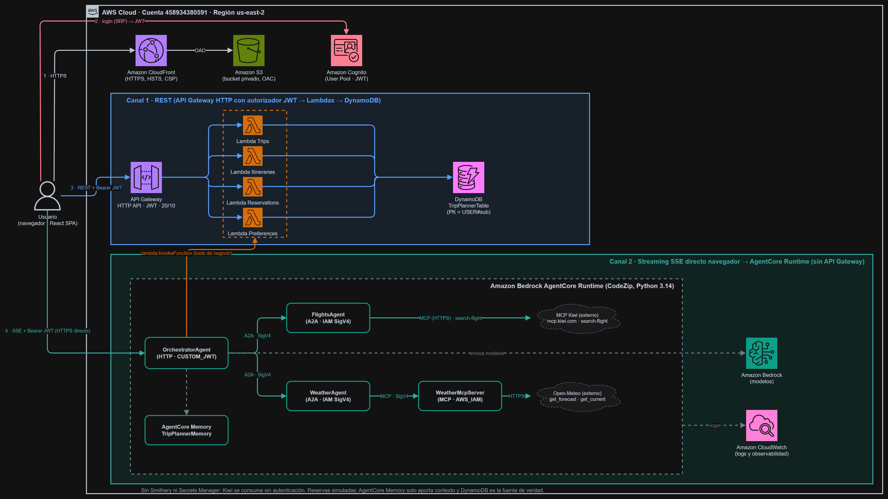

# TripPlanner AI

Planificador de viajes con un asistente conversacional: busca **vuelos reales** (MCP de Kiwi), consulta el **clima** (MCP propio sobre Open-Meteo), crea el viaje, genera el itinerario, registra reservas **simuladas** y lo guarda todo en DynamoDB, con una interfaz web para revisarlo y editarlo.

**Aplicación:** https://d2d27liabon15k.cloudfront.net · **Repositorio:** https://github.com/EdwinBlanco24/tripplanner-ai

Autores: **Edwin Blanco** y **David Pérez** · Programación Agéntica.

## Contenido

1. [Cómo evaluar](#1-cómo-evaluar)
2. [Arquitectura](#2-arquitectura)
3. [Agentes y MCP](#3-agentes-y-mcp)
4. [Tools](#4-tools)
5. [Datos](#5-datos)
6. [Seguridad](#6-seguridad)
7. [Funcionalidades](#7-funcionalidades)
8. [Correspondencia con la rúbrica](#8-correspondencia-con-la-rúbrica)
9. [Despliegue desde cero (Windows)](#9-despliegue-desde-cero-windows)
10. [Pruebas](#10-pruebas)
11. [Estructura del repositorio y roadmap](#11-estructura-del-repositorio-y-roadmap)
12. [Evidencias](#12-evidencias)

---

## 1. Cómo evaluar

### Acceso

- **Cuenta de evaluación:** `profesor.tripplanner@example.com` (ya confirmada y sin datos). La contraseña **se entrega por el canal de la asignatura**.
- **O registrarse:** en la pantalla de acceso, pestaña «Crear cuenta». Cognito envía un código de 6 dígitos desde `no-reply@verificationemail.com` (revisar también la carpeta de spam); se escribe en la pestaña «Confirmar código».

### Recorrido guiado (los 12 pasos del escenario)

Las respuestas del asistente tardan **entre 30 y 90 segundos** (consulta a otros agentes y a servicios externos); mientras tanto la pantalla muestra líneas de progreso, así que no hace falta reenviar nada.

| # | Paso del escenario | Qué pulsar | Qué se observa |
|---|---|---|---|
| 1 | El usuario ingresa | Abrir la URL, escribir correo y contraseña y pulsar **Entrar** | Se abre el Dashboard con el menú Asistente · Vuelos · Clima · Mis viajes · Reservas. |
| 2 | Habla con el asistente | Menú **Asistente** → primer chip de sugerencias (*«Quiero organizar unas vacaciones de cuatro días en Cartagena…»*) | La frase del escenario queda en el chat y se envía. |
| 3 | El Orchestrator interpreta | (automático) | Línea de estado «Asistente» y la propuesta de fechas concretas (no pregunta primero: propone el jueves más próximo con 7 días de antelación y 4 días de duración). |
| 4 | Vuelos vía MCP | (automático) | Línea «Vuelos · Consultando el agente de vuelos…»: Orchestrator → FlightsAgent (A2A) → MCP de Kiwi. |
| 5 | Clima vía MCP | (automático) | Línea «Clima · Consultando el agente de clima…»: Orchestrator → WeatherAgent (A2A) → WeatherMcpServer (MCP) → Open-Meteo. |
| 6 | El frontend presenta | (automático) | El lienzo de la derecha abre las pestañas **Vuelos** (tarjetas con aerolínea, horarios, escalas y precio) y **Clima** (días con temperaturas y probabilidad de lluvia); el texto del chat es breve. |
| 7 | Crear el viaje | Acción rápida **Crear el viaje** | El asistente crea el viaje (presupuesto, viajeros, fechas) y aparece la pestaña **Viaje**. |
| 8 | Itinerario | Acción rápida **Generar itinerario con actividades** | Pestaña **Itinerario** con las actividades día a día, acordes al clima. |
| 9 | Reserva | En la pestaña **Vuelos**, botón **Reservar** de una tarjeta | Reserva `SIMULADA` registrada; pestaña **Reservas**. |
| 10 | Persistencia en DynamoDB | Menú **Mis viajes** y **Reservas** (o la consola de DynamoDB, tabla `TripPlannerTable`) | El viaje, su itinerario y la reserva existen como ítems `USER#<sub>`. |
| 11 | Cierra la sesión | Menú de usuario (arriba a la derecha) → **Cerrar sesión** | Vuelve a la pantalla de acceso. |
| 12 | Vuelve y recupera | **Entrar** otra vez → **Mis viajes** → abrir el viaje; **Reservas**; o en el asistente «Muéstrame mis reservas» | Todo sigue ahí: viaje, itinerario y reservas. |

Extras que se pueden probar en cualquier momento: **Descargar PDF** del viaje y de cada reserva, el panel de **presupuesto** del detalle del viaje y **Mis preferencias** (se llega con el **engranaje** ⚙ junto al usuario, desde el menú del correo ▾ → «Mis preferencias» o, en móvil, desde el menú ☰) con el chip «Recomiéndame actividades según mis preferencias».

---

## 2. Arquitectura



Fuente editable: [`docs/arquitectura-tripplanner.drawio`](docs/arquitectura-tripplanner.drawio) · Detalle y decisiones (ADR-01 a ADR-13): [`docs/01-arquitectura.md`](docs/01-arquitectura.md).

Hay **dos canales** que comparten el mismo usuario (`sub` de Cognito) y la misma tabla:

- **Canal 1 · REST (negocio).** Navegador → CloudFront (frontend estático en S3 privado con OAC) → **API Gateway HTTP API** con **autorizador JWT de Cognito** → **cuatro Lambdas** (Trips, Itineraries, Reservations, Preferences) → **DynamoDB**. Sirve a las pantallas de viajes, reservas y preferencias.
- **Canal 2 · Streaming SSE directo (sin API Gateway).** El navegador llama por HTTPS **directamente al runtime del OrchestratorAgent en AgentCore** con el JWT de Cognito (AgentCore valida el token: inbound `CUSTOM_JWT`) y lee la respuesta como eventos SSE (`status`, `ui`, `text`, `error`, `done`). Así lo exige el enunciado: la interacción agéntica no pasa por API Gateway. AgentCore responde `Access-Control-Allow-Origin: *`, probado desde CloudFront (ADR-07).

Las Lambdas son la única puerta a DynamoDB: el canal 1 las usa vía API Gateway y el Orchestrator (canal 2) las invoca con `lambda:InvokeFunction`, de modo que las reglas de negocio están en un solo lugar (ADR-02, ADR-03).

Stacks (región `us-east-2`): `tripplanner-backend` (SAM), `AgentCore-TripPlannerA2A-default` (CLI `agentcore` 0.28.1) y `tripplanner-frontend` (S3 + CloudFront con OAC).

Recursos desplegados: API `https://g636zxc5fi.execute-api.us-east-2.amazonaws.com` · Cognito pool `us-east-2_hVc7JUyoG`, cliente `27ri7q3j4etl4nm5ht6oki040r`.

---

## 3. Agentes y MCP

| Runtime (AgentCore) | Protocolo / entrada | Rol |
|---|---|---|
| **OrchestratorAgent** | HTTP · JWT de Cognito (`CUSTOM_JWT`) | Entiende la solicitud, decide a quién delegar o qué tool de negocio usar, redacta la respuesta y emite el stream. Obtiene el `userId` del JWT (nunca del modelo). |
| **FlightsAgent** | A2A · IAM SigV4 | Busca vuelos con el MCP de Kiwi (`https://mcp.kiwi.com`, tool `search-flight`, externo y sin autenticación). |
| **WeatherAgent** | A2A · IAM SigV4 | Consulta el clima llamando por SigV4 al servidor MCP propio. |
| **WeatherMcpServer** | MCP · IAM | Servidor MCP propio (FastMCP) sobre Open-Meteo: tools `get_forecast` y `get_current_weather`. |

- **A2A con SigV4.** El Orchestrator invoca a FlightsAgent y a WeatherAgent mediante el protocolo A2A firmando con SigV4; esos agentes no aceptan JWT de usuarios.
- **MCP.** Dos servidores MCP reales: el de **Kiwi** (externo, vuelos) y el de **clima propio** desplegado como runtime de AgentCore (protocolo MCP), invocado con SigV4.
- **Agent-Driven UI.** Los componentes que dibuja el frontend (vuelos, clima, viaje, itinerario, reservas, preferencias) llegan como eventos `ui` **construidos por el código** a partir de resultados reales de las tools, no escritos por el modelo (ADR-10). El frontend ignora componentes desconocidos o con datos inválidos.
- **Memory frente a persistencia.** `TripPlannerMemory` (estrategias USER_PREFERENCE, SUMMARIZATION y SEMANTIC) solo aporta contexto conversacional. La **fuente de verdad** es DynamoDB; las preferencias que edita el usuario viven allí y mandan sobre lo inferido (ADR-06, ADR-13).
- **Reglas del prompt calculadas en código:** fecha de Bogotá, ventana de fechas propuesta y tasa de referencia (ADR-11, ADR-12).

Contrato completo del stream y de las tools: [`docs/04-tools-agentes.md`](docs/04-tools-agentes.md).

---

## 4. Tools

Las **15 tools de negocio** del Orchestrator se corresponden con las 8 mínimas del enunciado (en negrita) y añaden lecturas por id, borrado con confirmación y preferencias. Cada una invoca una Lambda con `userId` inyectado por el código.

| Tool | Mínima del enunciado | Lambda | Notas |
|---|---|---|---|
| `create_trip` | **CreateTrip** | Trips | Crea el viaje. |
| `get_trips` | **GetTrips** | Trips | Lista de viajes (filtro opcional por estado). |
| `update_trip` | **UpdateTrip** | Trips | Cambia campos o cancela. |
| `create_itinerary` | **CreateItinerary** | Itineraries | Itinerario día a día. |
| `update_itinerary` | **UpdateItinerary** | Itineraries | Reemplaza el itinerario. |
| `create_reservation` | **CreateReservation** | Reservations | Reserva simulada. |
| `get_reservations` | **GetReservations** | Reservations | Del usuario o de un viaje. |
| `update_reservation` | **UpdateReservation** | Reservations | Estado, proveedor, detalles o precio. |
| `get_trip` | (adicional) | Trips | Viaje con itinerario y reservas. |
| `delete_trip` | (adicional) | Trips | Borra en cascada; **exige confirmación explícita**. |
| `get_itinerary` | (adicional) | Itineraries | Lee el itinerario. |
| `get_reservation` | (adicional) | Reservations | Lee una reserva. |
| `delete_reservation` | (adicional) | Reservations | **Exige confirmación explícita**. |
| `get_preferences` | (adicional) | Preferences | Lee las preferencias del usuario. |
| `update_preferences` | (adicional) | Preferences | Guarda (reemplaza) las preferencias. |

Además, el Orchestrator tiene `ask_flights` y `ask_weather` para delegar en los especialistas por A2A. Parámetros, errores y ejemplos: [`docs/04-tools-agentes.md`](docs/04-tools-agentes.md).

---

## 5. Datos

**Tabla única** `TripPlannerTable` (DynamoDB on-demand, cifrado en reposo, PITR y protección contra borrado). Todo ítem de un usuario cuelga de `PK = USER#<sub>` (el `sub` del JWT):

| SK | Ítem |
|---|---|
| `PROFILE` | Perfil |
| `PREFS` | Preferencias explícitas |
| `TRIP#<tripId>` | Viaje |
| `TRIP#<tripId>#ITIN` | Itinerario (uno por viaje) |
| `TRIP#<tripId>#RES#<resId>` | Reserva |

Las reservas tienen estado `SIMULADA`, `PENDIENTE` o `CONFIRMADA` (todas son simuladas: no hay pasarela de pago). Borrar un viaje elimina en cascada su itinerario y sus reservas con una consulta por prefijo.

Detalle: [`docs/02-modelo-datos.md`](docs/02-modelo-datos.md) (ítems, patrones de acceso, consistencia) y [`docs/03-api.md`](docs/03-api.md) (endpoints, validaciones, errores).

---

## 6. Seguridad

- **IAM de mínimo privilegio con ARN específicos:** un rol por Lambda y por runtime; el Orchestrator solo tiene `lambda:InvokeFunction` sobre las cuatro funciones y WeatherAgent solo `InvokeAgentRuntime` sobre el runtime `WeatherMcpServer`.
- **Sin credenciales en el frontend:** el navegador solo maneja el JWT de Cognito (en memoria, no en `localStorage`); no hay claves de AWS ni secretos. `config.json` contiene únicamente identificadores públicos.
- **JWT en ambos canales:** autorizador JWT en API Gateway e inbound `CUSTOM_JWT` en AgentCore.
- **`actor_id` / `userId` solo desde el JWT:** nunca del cuerpo de la petición ni del modelo; las tools no tienen parámetro de usuario.
- **Validación en las Lambdas:** tipos, rangos, fechas y límites; campos desconocidos rechazados con 400; los agentes pueden equivocarse, las Lambdas no confían.
- **Aislamiento por usuario:** toda operación usa `PK = USER#<sub>` del token; un usuario no puede leer ni escribir datos de otro.
- **CORS con orígenes explícitos** en API Gateway (CloudFront y `localhost:5173`), y **throttling** 20 ráfaga / 10 por segundo.
- **Sin datos de tarjeta:** el prompt prohíbe pedirlos y las Lambdas rechazan campos de tarjeta y números con forma de tarjeta (13 a 19 dígitos) en las notas.
- **Bucket S3 privado con OAC:** solo CloudFront puede leerlo.
- **Cabeceras de seguridad en CloudFront:** HSTS (1 año), `Content-Security-Policy` con `connect-src` limitado a la API, AgentCore y Cognito, `X-Frame-Options: DENY`, `nosniff` y `Referrer-Policy`.
- **Reservas simuladas:** no se procesan pagos.
- **Resultados de MCP como datos no confiables:** los prompts ordenan ignorar instrucciones incrustadas.

**Riesgos aceptados:** el rol de `WeatherMcpServer` conserva los permisos por defecto del CLI de AgentCore; Kiwi no ofrece SLA; el pronóstico llega solo a hoy + 15 días; la tasa de referencia USD/COP es aproximada y se configura en dos sitios (`frontend/public/config.json` y `REFERENCE_USD_COP` del Orchestrator); la cuota de correos de Cognito es baja (límite diario).

---

## 7. Funcionalidades

| Módulo | Qué hace |
|---|---|
| **Dashboard** | Resumen del usuario; sugiere configurar preferencias si aún no las tiene. |
| **Asistente** | Chat con streaming y lienzo con pestañas (Vuelos, Clima, Viaje, Itinerario, Reservas); acciones rápidas según el estado de la conversación; franja «Usando tus preferencias». |
| **Vuelos** | Formulario (origen, destino, fecha, pasajeros, franja horaria) que consulta al Orchestrator (FlightsAgent → MCP de Kiwi) con sesión propia; tarjetas de vuelos, reserva simulada y bloque «Continuar en el asistente». |
| **Clima** | Formulario de destino y fechas (hoy a +15 días) que consulta al Orchestrator (WeatherAgent → MCP propio → Open-Meteo), con continuación al asistente. |
| **Mis viajes** | Alta, edición, cancelación y detalle con itinerario editable, reservas, presupuesto y PDF. |
| **Reservas** | Lista, edición de estado y comprobante en PDF. |
| **Mis preferencias** | Estilos de viaje, ritmo, horario de vuelo, nivel de presupuesto y notas. Acceso: engranaje ⚙ de la cabecera, menú del usuario (correo ▾), menú ☰ en móvil, o el enlace «Editar mis preferencias» del Dashboard. |

**Opcionales implementados:** PDF real del viaje y de cada reserva (jsPDF cargado bajo demanda) · comparador de presupuesto (estado según el porcentaje usado, con tasa USD/COP de referencia) · recomendaciones personalizadas por preferencias.

**Descartado: agente de actividades.** Se evaluó un cuarto agente especializado en actividades y se descartó: la recomendación de actividades ya la resuelve el Orchestrator con el clima real y las preferencias del usuario, y un agente más añadiría otro runtime, otra política IAM y más latencia sin datos propios que justifiquen un MCP o una fuente externa.

---

## 8. Correspondencia con la rúbrica

| Criterio (peso) | Dónde se cumple |
|---|---|
| **UX (25 %)** | Interfaz React/PrimeReact con login dinámico (acceso, registro, confirmación), asistente con progreso visible y lienzo, acciones rápidas, PDF, presupuesto y preferencias; responsive; estados de carga y error. Pantallas y capturas: [§1](#1-cómo-evaluar), [§7](#7-funcionalidades) y [`docs/evidencias/`](docs/evidencias/). |
| **Integración agéntica (15 %)** | Orchestrator + FlightsAgent + WeatherAgent por A2A con SigV4, Memory y Agent-Driven UI: [§3](#3-agentes-y-mcp), ADR-06, ADR-08, ADR-10. |
| **Tools (15 %)** | 15 tools de negocio (las 8 mínimas del enunciado + adicionales) y 2 de delegación; confirmación de borrados, errores estructurados: [§4](#4-tools), [`docs/04-tools-agentes.md`](docs/04-tools-agentes.md). |
| **Lambda / API (15 %)** | 4 Lambdas con doble entrada, HTTP API con autorizador JWT, validación, errores uniformes, throttling y CORS: [`docs/03-api.md`](docs/03-api.md), [`backend/`](backend/), ADR-02. |
| **DynamoDB (15 %)** | Tabla única con `PK = USER#<sub>`, patrones de acceso por clave, borrado en cascada, PITR: [§5](#5-datos), [`docs/02-modelo-datos.md`](docs/02-modelo-datos.md), ADR-01. |
| **Arquitectura y seguridad (10 %)** | Dos canales, tres stacks, IAM mínimo, JWT en ambos canales, OAC y cabeceras: [§2](#2-arquitectura), [§6](#6-seguridad), [`docs/01-arquitectura.md`](docs/01-arquitectura.md). |
| **Documentación y demo (5 %)** | Este README, `docs/01` a `docs/04`, diagrama editable, recorrido guiado de evaluación, pruebas y guía de despliegue: [§1](#1-cómo-evaluar), [§9](#9-despliegue-desde-cero-windows), [§10](#10-pruebas), [§12](#12-evidencias). |

---

## 9. Despliegue desde cero (Windows)

### Requisitos

| Herramienta | Versión usada |
|---|---|
| AWS CLI v2 con un perfil (`agentic-workshop`) y permisos de despliegue en `us-east-2` | — |
| AWS SAM CLI | 1.174.0 |
| CLI de AgentCore (`agentcore`) | 0.28.1 (no actualizar) |
| Node.js | 24.20.0 |
| Python | 3.14.7 (los runtimes usan `PYTHON_3_14`; las Lambdas, 3.13: `sam build` necesita Python 3.13 en el PATH o `--use-container`) |
| `uv` | Para los agentes Python |

En PowerShell: `$env:AWS_PROFILE = 'agentic-workshop'`.

### Orden

1. **Backend (SAM).**
   ```powershell
   cd backend
   sam validate --lint
   sam build
   sam deploy --guided   # primera vez; AllowedOrigins = http://localhost:5173 por ahora
   ```
   Anotar los Outputs: `ApiUrl`, `UserPoolId`, `UserPoolClientId`, `JwtIssuer` y los ARN de las cuatro funciones.

2. **Agentes (`agentcore deploy`, en dos pasos por el ARN del MCP).**
   - En `TripPlannerA2A/agentcore/agentcore.json` poner los ARN de las Lambdas en las variables del Orchestrator, y el `discoveryUrl` y `allowedClients` de Cognito; en `policies/orchestrator-invoke-business-lambdas.json`, los mismos ARN.
   - **Paso 1:** `cd TripPlannerA2A; agentcore validate; agentcore deploy --target default` (crea los runtimes y la Memory, incluido `WeatherMcpServer`).
   - Leer el ARN del runtime `WeatherMcpServer` (consola de AgentCore o la salida del despliegue) y ponerlo en `WEATHER_MCP_RUNTIME_ARN` de WeatherAgent.
   - **Paso 2:** volver a ejecutar `agentcore deploy --target default`.
   - Anotar el ARN del runtime del Orchestrator.

3. **Stack del frontend (S3 + CloudFront).**
   ```powershell
   cd infra\frontend
   sam deploy   # usa samconfig.toml; parámetros ApiOrigin, AgentCoreOrigin y CognitoOrigin
   ```
   Anotar `AppUrl`, `BucketName` y `DistributionId`.

4. **CORS del backend.** Añadir el dominio de CloudFront a `AllowedOrigins` en `backend\samconfig.toml` (`parameter_overrides`) y volver a ejecutar `sam deploy` en `backend`.

5. **Configuración y publicación del frontend.** Completar `frontend\public\config.json` (`apiUrl`, `userPoolId`, `userPoolClientId`, `orchestratorRuntimeArn`, `exchangeRates`) y publicar:
   ```powershell
   cd frontend
   npm ci
   .\scripts\deploy-frontend.ps1   # build, subida a S3 con Cache-Control e invalidación de CloudFront
   ```

6. **Verificar.** `backend\scripts\smoke-test.ps1 -Email <correo> -Cleanup` (ver [§10](#10-pruebas)) y el recorrido de [§1](#1-cómo-evaluar).

Para cambios posteriores solo del Orchestrator: `agentcore deploy --diff --target default` muestra qué cambia (normalmente solo el hash del zip) y `agentcore deploy --target default` lo despliega.

---

## 10. Pruebas

Conteos obtenidos al ejecutar las suites en el sprint S7:

| Suite | Resultado | Cómo ejecutarla |
|---|---|---|
| Frontend (Vitest + Testing Library) | **256 pruebas en 29 archivos**, todas correctas | `cd frontend; npm run test` |
| Backend (unittest, sin red) | **116 pruebas** correctas (4 omitidas) | `cd backend\tests; $env:PYTHONPATH='..\src'; python -m unittest test_validation test_other_handlers test_runtime test_trips_handler test_ids_and_events` |
| Agentes: planificación y prompt | 21 | `cd TripPlannerA2A; python -m unittest test_s6_1_planning` |
| Agentes: tools de negocio | 50 | `python -m unittest test_s3_business_tools` |
| Agentes: formato y días de la semana | 2 + 7 | `python -m unittest test_s5_1_format test_s5_weekday` |
| Agentes: vuelos, clima y lugares | 22 + 18 + 12 | `python -m unittest test_s3c_flights test_s3c_weather test_s4_3_places` |

Total de agentes: **132 pruebas**. Para las suites de agentes se necesita `PYTHONPATH` con `app\OrchestratorAgent;app\FlightsAgent;app\WeatherAgent;app\WeatherMcpServer` y un entorno con las dependencias de los agentes instaladas.

Comprobaciones adicionales: `cd frontend; npm run lint; npm run build` y `sam validate --lint` / `agentcore validate`.

**Smoke test del backend desplegado:** `backend\scripts\smoke-test.ps1 -Email <correo> [-Cleanup]` crea (o reutiliza) un usuario de prueba, obtiene el token de Cognito sin imprimirlo, recorre la API con casos felices y negativos e imprime una tabla Paso / Esperado / Obtenido. Pide la contraseña de forma interactiva.

Los scripts `test_*_a2a.py` y `s3_stream_test.py` de `TripPlannerA2A/` son pruebas manuales contra recursos desplegados y no se cuentan arriba.

---

## 11. Estructura del repositorio y roadmap

```text
a2a-trip-planner/
├── README.md
├── app/                       Código de los runtimes de AgentCore
│   ├── OrchestratorAgent/     main.py (prompt, stream), business_tools.py (tools de negocio)
│   ├── FlightsAgent/          A2A + MCP Kiwi
│   ├── WeatherAgent/          A2A + cliente SigV4 del MCP de clima
│   └── WeatherMcpServer/      servidor MCP (FastMCP) sobre Open-Meteo
├── TripPlannerA2A/            Proyecto del CLI agentcore (agentcore.json, políticas) y pruebas de agentes
├── backend/                   SAM: template.yaml, src/ (4 Lambdas + common/), tests/, scripts/smoke-test.ps1
├── frontend/                  Vite + React + TS (src/, scripts/deploy-frontend.ps1, docs-evidencia/)
├── infra/frontend/            SAM del frontend (S3 privado + CloudFront con OAC, CSP)
├── docs/                      01-arquitectura, 02-modelo-datos, 03-api, 04-tools-agentes, diagrama, evidencias/
└── spike/                     Spike del streaming desde el navegador (S2)
```

| Sprint | Contenido | Commit |
|---|---|---|
| S0 | Diseño, documentación y diagrama | `5f0fc5e` |
| S1 | Backend SAM (Cognito, HTTP API con JWT, 4 Lambdas, DynamoDB) | `013df0a` |
| S2 | Inbound CUSTOM_JWT en el Orchestrator y prueba de streaming desde el navegador | `615c70d` |
| S3b | Tools de negocio, stream tipado y reservas desde el chat | `d49f766` |
| S3c | Kiwi directo y MCP de clima propio en AgentCore | `7458f5e` |
| S4 | Frontend Vite con Cognito, viajes y reservas | `77fedf5` |
| S5 | Asistente con streaming, vuelos y clima | `d6bb7aa` |
| S6 | Frontend publicado en S3 + CloudFront | `5c983f7` |
| S6.1–S6.2 | Login dinámico, flujo de evaluación, continuar al asistente | `327a77d` |
| OP1–OP2 | PDF real y comparador de presupuesto | `60d4b3d` |
| OP3 | Preferencias y recomendaciones personalizadas | `38ac845` |
| S7 | Documentación final, diagrama y limpieza | (este sprint; pendiente de commit) |

---

## 12. Evidencias

- **Aplicación desplegada y consola de AWS:** [`docs/evidencias/`](docs/evidencias/) (el README de esa carpeta explica qué muestra cada captura). Archivos esperados: `01-login.png`, `02-asistente-solicitud.png`, `03-04-05-orquestacion-vuelos-clima.png`, `06-resultados.png`, `07-viaje-creado.png`, `08-itinerario.png`, `09-reserva.png`, `10-dynamodb.png`, `11-12-recupera-datos.png`, `13-pdf-viaje.png`, `14-presupuesto.png`, `15-preferencias.png`, `16-cloudwatch-mcp.png`, `17-agentcore-runtimes.png`.
- **Capturas de desarrollo** (rutas de pruebas locales con datos de ejemplo): [`frontend/docs-evidencia/`](frontend/docs-evidencia/).

---

*Edwin Blanco y David Pérez · Programación Agéntica.*
