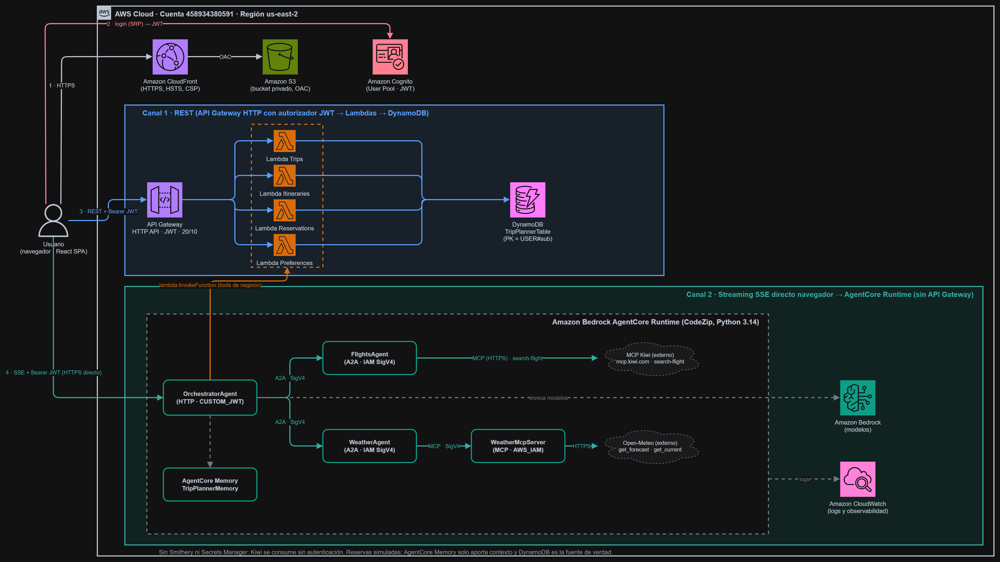

# TripPlanner AI — Arquitectura

Estado: **final (Sprint S7)** · Región `us-east-2` · Cuenta `458934380591` · App: https://d2d27liabon15k.cloudfront.net

TripPlanner AI convierte el TripPlanner del taller (tres agentes Strands en AgentCore) en una aplicación web con **dos canales** que comparten la misma base de datos y el mismo usuario autenticado:

| Canal | Para qué sirve | Ruta |
|---|---|---|
| **1 · REST (negocio)** | Pantallas clásicas: viajes, itinerarios, reservas y preferencias | Frontend → API Gateway (HTTP API, autorizador JWT de Cognito) → Lambda → DynamoDB |
| **2 · Streaming agéntico (sin API Gateway)** | Conversación en lenguaje natural con streaming SSE | Frontend → HTTPS **directo** a AgentCore Runtime (JWT de Cognito) → OrchestratorAgent → FlightsAgent / WeatherAgent / Tools de negocio → Lambdas → DynamoDB |

Diagrama: `docs/arquitectura-tripplanner.drawio` (editable con diagrams.net) y su exportación `docs/arquitectura-tripplanner.png` / `.svg`.



## 1. Vista general

```text
Usuario ── CloudFront (HTTPS, HSTS, CSP) ── S3 privado (OAC) · Vite + React + TypeScript
   │
   ├─ login ───────────────► Amazon Cognito (User Pool, JWT)
   │
   ├─ Canal 1 REST (JWT) ──► API Gateway HTTP (autorizador JWT, 20/10) ─► Lambdas (Trips · Itineraries · Reservations · Preferences) ─► DynamoDB
   │
   └─ Canal 2 SSE (JWT) ───► AgentCore Runtime · OrchestratorAgent (inbound CUSTOM_JWT, sin API Gateway)
                               ├─ A2A (SigV4) ─► FlightsAgent ─► MCP Kiwi (https://mcp.kiwi.com, externo, sin autenticación)
                               ├─ A2A (SigV4) ─► WeatherAgent ─► (MCP, SigV4) WeatherMcpServer (AgentCore Runtime) ─► Open-Meteo (externo)
                               ├─ Tools ─ lambda:InvokeFunction ─► las mismas 4 Lambdas ─► DynamoDB
                               ├─ AgentCore Memory (TripPlannerMemory)
                               └─ Amazon Bedrock (modelos)
Transversales: CloudWatch (logs y observabilidad) · IAM (mínimo privilegio)
```

Stacks: `tripplanner-backend` (SAM: Cognito, HTTP API, 4 Lambdas, DynamoDB), `AgentCore-TripPlannerA2A-default` (CLI `agentcore` 0.28.1: 4 runtimes + Memory) y `tripplanner-frontend` (S3 + CloudFront con OAC).

## 2. Componentes

| Componente | Responsabilidad | Notas de diseño |
|---|---|---|
| **Frontend** (Vite + React 19 + TS + PrimeReact) | Interfaz de ambos canales: Dashboard, Asistente, Vuelos, Clima, Mis viajes, Reservas y Mis preferencias | Publicado en S3 + CloudFront (ADR-09). Guarda los tokens de Cognito en memoria (no en `localStorage`). Lee el stream por `fetch` + `ReadableStream`. Rutas con carga diferida; PDF real con jsPDF cargado bajo demanda. |
| **Amazon Cognito** | Registro, login y emisión de JWT | User Pool con un app client público (sin secreto). Verificación por correo (código desde `no-reply@verificationemail.com`). El claim `sub` es el identificador de usuario en todo el sistema. |
| **API Gateway (HTTP API)** | Entrada del canal 1 | Autorizador JWT nativo (issuer del User Pool, audiencia = app client). CORS con orígenes explícitos, throttling 20 ráfaga / 10 por segundo, logs de acceso. |
| **AWS Lambda** | Lógica de negocio | Cuatro funciones (Trips, Itineraries, Reservations, Preferences). Cada una acepta dos tipos de evento (ADR-02) y comparte código de negocio. Python 3.13, 256 MB, 10 s. |
| **DynamoDB** | Fuente de verdad del negocio | Tabla única `TripPlannerTable`, on-demand, cifrado en reposo, PITR y protección contra borrado (ADR-01). |
| **AgentCore Runtime** | Aloja los agentes y el servidor MCP de clima | OrchestratorAgent (protocolo HTTP, inbound CUSTOM_JWT); FlightsAgent y WeatherAgent (protocolo A2A, IAM SigV4); WeatherMcpServer (protocolo MCP, inbound AWS_IAM). |
| **Strands Agents** | Marco de los agentes | Orquestación con tools, sesiones y memoria. |
| **MCP Kiwi** | Vuelos reales | Servidor oficial `https://mcp.kiwi.com` (Streamable HTTP, sin autenticación). Solo se expone al modelo la tool `kiwi_search_flight` (lista blanca; en Kiwi se llama `search-flight`). |
| **WeatherMcpServer** | Pronóstico | Servidor MCP propio (FastMCP, Streamable HTTP, stateless) sobre Open-Meteo (sin API key). Tools `get_forecast` y `get_current_weather`. WeatherAgent lo invoca firmando con SigV4 (ADR-08). |
| **AgentCore Memory** | Contexto conversacional | `TripPlannerMemory` con estrategias USER_PREFERENCE, SUMMARIZATION y SEMANTIC. `actorId` = `sub` del usuario (ADR-06). |
| **S3 + CloudFront** | Hosting estático | Bucket privado con Origin Access Control, HTTPS obligatorio, cabeceras de seguridad (HSTS, CSP, X-Frame-Options, nosniff, Referrer-Policy) y fallback de SPA a `index.html` (ADR-09). |
| **IAM** | Control de acceso | Un rol por función y por runtime; el Orchestrator solo puede invocar las cuatro Lambdas (ADR-03); WeatherAgent solo puede invocar el runtime WeatherMcpServer (ADR-08). |
| **CloudWatch** | Observabilidad | Logs de las Lambdas y de acceso de API Gateway (retención de 14 días) y logs y trazas de los runtimes de AgentCore. |

## 3. Flujos principales

**Canal 1 (negocio).** El usuario inicia sesión en Cognito y el frontend envía el *access token* en `Authorization: Bearer`. API Gateway valida firma, emisor y audiencia; la Lambda recibe el `sub` en `requestContext.authorizer.jwt.claims` y opera solo sobre `PK = USER#<sub>`.

**Canal 2 (agéntico).** El frontend abre una petición HTTPS con streaming a la URL de invocación del runtime del Orchestrator con el mismo token. AgentCore valida el JWT (CUSTOM_JWT). El Orchestrator obtiene el `userId` del token, decide qué especialistas o tools usar y emite eventos JSON por SSE (contrato en `04-tools-agentes.md`). Las tools de negocio invocan las Lambdas directamente; no pasan por API Gateway.

**Coherencia entre canales.** Ambos canales escriben en la misma tabla con el mismo `sub`, así que un viaje creado por el chat aparece en las pantallas de negocio y viceversa (`createdBy` registra el origen).

## 4. Seguridad (resumen)

- El `userId` **siempre** sale del claim `sub` de un JWT validado. Nunca lo envía el cliente en el cuerpo ni lo decide el LLM.
- Las tools del agente no tienen parámetro `userId`; el código del Orchestrator lo inyecta.
- Mínimo privilegio: cada Lambda accede solo a su tabla y acciones; el runtime del Orchestrator solo tiene `lambda:InvokeFunction` sobre las cuatro funciones.
- FlightsAgent y WeatherAgent no son accesibles desde internet con JWT: siguen con IAM SigV4 y solo aceptan al rol del Orchestrator.
- No se almacenan datos de tarjetas ni se procesan pagos (las Lambdas rechazan campos de tarjeta y números con forma de tarjeta en las notas). Las reservas son **simuladas**.
- Los resultados de MCP son datos no confiables: los prompts de los agentes ordenan ignorar instrucciones incrustadas en ellos.
- Sin credenciales en el frontend ni secretos en el repositorio.

## 5. Registro de decisiones (ADR)

### ADR-01 · Tabla única DynamoDB con `PK = USER#<sub>`

- **Contexto.** Los datos son pequeños, siempre se consultan por usuario y por viaje, y se necesita borrar un viaje con todo lo suyo.
- **Decisión.** Una sola tabla `TripPlannerTable` (on-demand) con `PK` (string) y `SK` (string). Perfil, preferencias, viajes, itinerarios y reservas viven bajo la misma `PK = USER#<sub>`; el `SK` los distingue (`PROFILE`, `PREFS`, `TRIP#<id>`, `TRIP#<id>#ITIN`, `TRIP#<id>#RES#<id>`).
- **Alternativas.** (a) Una tabla por entidad: más recursos y más permisos, sin beneficio a esta escala. (b) RDS/Aurora: coste fijo y VPC innecesarios.
- **Consecuencias.** Todas las lecturas son `Query`/`GetItem` por clave, sin joins. El aislamiento por usuario se logra con la clave. El borrado en cascada es una consulta por prefijo. Si aparecen accesos por otro eje (p. ej. todas las reservas por fecha) habrá que añadir un GSI (ver `02-modelo-datos.md`).

### ADR-02 · Una Lambda por recurso con dos entradas

- **Contexto.** El mismo negocio debe poder invocarse desde API Gateway (canal 1) y desde las tools del agente (canal 2) sin duplicar reglas.
- **Decisión.** Cuatro Lambdas: Trips, Itineraries, Reservations y Preferences. Cada una detecta el tipo de evento: (1) evento de API Gateway HTTP API (payload 2.0), o (2) evento directo de la tool `{"source":"agent","action":"...","userId":"...","payload":{...}}`. Ambos caminos llaman a la misma lógica de negocio (validación, acceso a DynamoDB) en un módulo compartido.
- **Alternativas.** (a) Una Lambda monolítica: menos aislamiento de permisos y despliegues más grandes. (b) Lambdas separadas para API y para agente: duplica validaciones y las deja divergir. (c) Que el agente llame a la API por HTTP: añade latencia y obliga a gestionar credenciales (ver ADR-03).
- **Consecuencias.** Un único punto de validación. El evento directo es un contrato interno que debe versionarse (`04-tools-agentes.md`). Hay que probar ambas entradas con los mismos casos.

### ADR-03 · Las tools invocan Lambdas con `lambda:InvokeFunction`

- **Contexto.** El Orchestrator corre en AgentCore con un rol IAM propio; el JWT del usuario no es una credencial para API Gateway en el lado del servidor.
- **Decisión.** Las tools usan `boto3.client("lambda").invoke` (síncrono) con el rol del runtime. La política concede solo `lambda:InvokeFunction` sobre los ARN de las cuatro funciones.
- **Alternativas.** (a) Llamar a API Gateway con el JWT reenviado: requiere pasar el token a las tools y gestionar expiración. (b) Llamar a API Gateway con SigV4: exige una segunda forma de autorización en la API. (c) Acceso directo a DynamoDB desde el agente: se salta las validaciones de negocio.
- **Consecuencias.** Menos saltos y sin dependencia de la API pública. La confianza en `userId` descansa en que **solo** el rol del Orchestrator puede invocar las funciones con `source: "agent"`. Los ARN de las Lambdas llegan al agente como variables de entorno.

### ADR-04 · Autenticación con Cognito

- **Contexto.** Hay dos puertas de entrada (API Gateway y AgentCore) y se necesita una identidad única y no falsificable.
- **Decisión.** Un Cognito User Pool. API Gateway usa un **JWT authorizer** (emisor del pool, audiencia = app client). El runtime del OrchestratorAgent usa **inbound CUSTOM_JWT** (`discoveryUrl` del pool y `allowedClients` = app client; los *access tokens* de Cognito traen `client_id`, no `aud`). El frontend envía el *access token* a ambos. `userId` = claim `sub`. FlightsAgent y WeatherAgent siguen con IAM SigV4 porque solo los llama el Orchestrator.
- **Alternativas.** (a) Claves de API: no identifican personas. (b) Identity Pool con SigV4 desde el navegador: expone credenciales AWS temporales al cliente y complica el mínimo privilegio por usuario. (c) IdP externo (Auth0, Google): más piezas para un trabajo académico.
- **Consecuencias.** El Orchestrator pasa de IAM a CUSTOM_JWT: `agentcore invoke` desde el CLI necesita un token. El runtime recibe el encabezado `Authorization` (`requestHeaderAllowlist`) para leer el `sub`; como AgentCore ya validó la firma, el código solo decodifica el payload. El `sub` se usa también como `actorId` de AgentCore Memory.

### ADR-05 · IaC: AWS SAM para el backend y el CLI `agentcore` para los agentes

- **Contexto.** El backend serverless (Cognito, API, Lambdas, DynamoDB) se despliega bien con SAM. Los agentes ya se gestionan con el CLI `agentcore` (proyecto CDK generado, con empaquetado CodeZip y `agentcore.json`).
- **Decisión.** **Tres stacks**: `backend/template.yaml` (SAM), el proyecto AgentCore existente y `infra/frontend/template.yaml` (S3 + CloudFront). SAM exporta los ARN y el *issuer*/client de Cognito; `agentcore.json` los consume mediante `envVars` y `additionalPolicies`.
- **Alternativas.** (a) Todo en SAM: SAM no modela runtimes de AgentCore con el flujo del CLI. (b) Todo en CDK propio: se pierde el empaquetado y las convenciones del CLI. (c) Consola manual: no reproducible.
- **Consecuencias.** Orden de despliegue: SAM primero (crea Lambdas y Cognito), después los agentes (necesitan sus ARN), por último el frontend (necesita los orígenes de la API y de AgentCore para la CSP). Hay un acoplamiento manual por valores; cada stack se puede revertir por separado.

### ADR-06 · Memory ≠ persistencia

- **Contexto.** AgentCore Memory extrae preferencias y resúmenes de la conversación, pero su contenido es inferido, no auditable y expira.
- **Decisión.** AgentCore Memory solo aporta **contexto y preferencias conversacionales** (p. ej. "prefiere vuelos de mañana"). **DynamoDB es la fuente de verdad** de viajes, itinerarios, reservas y de las preferencias que el usuario edita en pantalla (ver ADR-13).
- **Alternativas.** (a) Guardar todo en Memory: no es consultable ni editable desde el canal 1. (b) Ignorar Memory: pierde personalización entre sesiones.
- **Consecuencias.** Pueden existir dos "preferencias" (inferida y explícita); la explícita de DynamoDB manda. Ninguna operación de negocio puede depender de Memory.

### ADR-07 · Consumir el streaming de AgentCore desde el navegador — **RESUELTO (plan A)**

- **Contexto.** El canal 2 llama a AgentCore directamente desde el navegador con un JWT. No estaba verificado que el endpoint de invocación respondiera al preflight CORS ni cómo entregaba el streaming.
- **Decisión.** **Plan A**: llamada directa con `fetch` y `Authorization: Bearer`, leyendo `data:` línea a línea. Se validó en el spike del sprint S2 y en producción.
- **Resultado.** AgentCore responde `Access-Control-Allow-Origin: *` (y gestiona el preflight), de modo que la petición funciona desde el origen de CloudFront; está probado desde https://d2d27liabon15k.cloudfront.net. El **plan B** (proxy con streaming) **no fue necesario** y no existe en la arquitectura. La CSP del frontend incluye el origen de AgentCore en `connect-src`.
- **Alternativas descartadas.** (a) API Gateway delante de AgentCore: descartado por requisito (el canal 2 no usa API Gateway) y por el límite de tiempo de integración. (b) WebSocket propio: más infraestructura.
- **Consecuencias.** El contrato de eventos (`04-tools-agentes.md`) es el mismo que se diseñó. El `*` de CORS no es un riesgo adicional: la protección es el JWT, no el origen.

### ADR-08 · Sin Smithery: Kiwi directo y un MCP de clima propio en AgentCore

> Histórico: Smithery se usó en sprints anteriores y se retiró en S3c. Ya no forma parte de la arquitectura.

- **Contexto.** Smithery dejó de ser viable como proxy del MCP de Kiwi (retirado el 31/10/2026) y exigía una API key en Secrets Manager. El clima aún no tenía fuente real. Además, el evento `ui:flights` nunca se emitía: el agente de vuelos devolvía el bloque JSON dentro de un texto fragmentado en cientos de partes y el Orchestrator leía `str(result.message)` (la representación de un diccionario, con los saltos de línea escapados), de modo que el bloque no se encontraba.
- **Decisión.** (1) FlightsAgent se conecta a `https://mcp.kiwi.com` sin cabecera de autenticación; se eliminan el secreto y su política (el archivo de política se borró en S7). (2) El clima lo sirve `WeatherMcpServer`, un runtime AgentCore con protocolo MCP (puerto 8000, ruta `/mcp`, HTTP sin estado, entrada `AWS_IAM`) sobre Open-Meteo; WeatherAgent lo invoca con `bedrock-agentcore:InvokeAgentRuntime` y SigV4 (servicio `bedrock-agentcore`), con una política acotada a `runtime/TripPlannerA2A_WeatherMcpServer-*`. (3) Los bloques `flights` y `weather` **los construye el código** del agente a partir del resultado real de la tool (ver ADR-10).
- **Alternativas.** (a) Seguir con Smithery: servicio retirado. (b) Un MCP de clima público de terceros: sin control de contrato ni disponibilidad. (c) Una tool Python dentro de WeatherAgent: no cumple el objetivo de practicar MCP sobre AgentCore. (d) Dejar que el LLM escriba el JSON: fue la causa del defecto.
- **Consecuencias.** Se elimina un secreto y su política. El ARN del runtime MCP solo se conoce tras el primer despliegue, por lo que el despliegue es en dos pasos (la variable `WEATHER_MCP_RUNTIME_ARN` de WeatherAgent se añade en el segundo). Sin esa variable WeatherAgent responde de forma honesta que no puede consultar el clima. El pronóstico cubre hoy y los 15 días siguientes (límite de Open-Meteo); fuera de ese horizonte el servidor devuelve un error claro. Kiwi no ofrece autenticación ni SLA: una caída de `mcp.kiwi.com` se traduce en el mismo fallback honesto de vuelos. Quedan referencias a Smithery en `app/FlightsAgent/main.py` (rutas de compatibilidad que solo actúan si la URL del MCP es de Smithery) y en scripts de prueba históricos de `TripPlannerA2A/`.

### ADR-09 · Frontend en S3 + CloudFront con OAC y CSP

- **Contexto.** Hace falta un origen HTTPS para el frontend, sin servidores que operar, y las cabeceras de seguridad no pueden depender de código de la aplicación.
- **Decisión.** Un stack propio (`infra/frontend/template.yaml`): bucket S3 **privado** (Block Public Access) accesible solo por CloudFront mediante **Origin Access Control**; distribución con HTTPS obligatorio, HTTP/2 y 3, y una *response headers policy* con HSTS (1 año, subdominios), `X-Content-Type-Options: nosniff`, `X-Frame-Options: DENY`, `Referrer-Policy: strict-origin-when-cross-origin` y **CSP** (`default-src 'self'`, `script-src 'self'`, `connect-src` solo con los orígenes de la API, de AgentCore y de Cognito, `frame-ancestors 'none'`). Los errores 403 y 404 se reescriben a `index.html` (SPA). `deploy-frontend.ps1` sube `dist\` con `Cache-Control` por tipo (assets inmutables, `index.html` y `config.json` sin caché) e invalida CloudFront.
- **Alternativas.** (a) Amplify Hosting: oculta la configuración de cabeceras y añade otro servicio. (b) Bucket con sitio web estático público: sin HTTPS propio ni control de acceso. (c) Servir desde una Lambda: complejidad sin beneficio.
- **Consecuencias.** Los orígenes de la CSP son parámetros del stack; si cambia el origen de la API o de AgentCore hay que actualizar el stack. `style-src` conserva `'unsafe-inline'` (estilos de PrimeReact). La configuración en tiempo de ejecución (`config.json`) permite cambiar IDs sin recompilar.

### ADR-10 · Bloques Agent-Driven UI construidos en código, no por el modelo

- **Contexto.** El frontend renderiza componentes (vuelos, clima, viaje, itinerario, reservas, preferencias) a partir de eventos `ui`. Cuando el modelo escribía el JSON, a veces lo truncaba, lo reformulaba o lo omitía.
- **Decisión.** Los eventos `ui` los emite **el código**: las tools de negocio los emiten tras una respuesta `ok:true` de la Lambda, y los bloques `flights` y `weather` los construye el código de cada especialista a partir del resultado real de su tool MCP (hook `AfterToolCallEvent`), anexándolos al final del stream. El Orchestrator los valida y los reenvía; el modelo solo redacta el texto. El frontend ignora componentes desconocidos, internos (`preferences` no crea pestaña) o con datos inválidos.
- **Alternativas.** (a) Pedir al modelo JSON estructurado: frágil y no verificable. (b) Que el frontend interprete el texto: ambiguo.
- **Consecuencias.** Lo que se ve en pantalla coincide con lo que devolvió la tool, no con lo que el modelo «recuerda». Cada componente tiene un esquema (`04-tools-agentes.md`, sección 4.1) que debe mantenerse sincronizado entre agentes y frontend.

### ADR-11 · Fecha de Bogotá y ventana de fechas calculadas en código

- **Contexto.** El runtime corre en UTC y el modelo no conoce la fecha ni calcula bien los días de la semana; a las 20:00 de Bogotá ya es «mañana» en UTC. Los usuarios piden viajes sin dar fechas.
- **Decisión.** El código del Orchestrator inyecta en el *system prompt* la fecha de hoy en `America/Bogota` (UTC-5 fijo, Colombia no tiene horario de verano) con su día de la semana, y calcula la **ventana propuesta por defecto**: 4 días, empezando el jueves más próximo con al menos 7 días de antelación, avisando si cae fuera del pronóstico de 16 días (hoy + 15). Los itinerarios y el clima usan el campo `weekday` de los datos; el modelo nunca calcula días de la semana. Si no hay fechas, el asistente **propone** fechas y consulta vuelos y clima en el mismo turno; no crea el viaje hasta que el usuario lo pide.
- **Alternativas.** (a) Dejar que el modelo infiera la fecha: errores de año y de día. (b) Pedir siempre las fechas al usuario: peor experiencia y rompe el escenario de evaluación.
- **Consecuencias.** Comportamiento determinista y probado con pruebas unitarias (`test_s6_1_planning.py`, `test_s5_weekday.py`).

### ADR-12 · Tasa de referencia USD/COP común

- **Contexto.** Kiwi devuelve precios en distintas monedas y los presupuestos se manejan en COP; el comparador de presupuesto y el asistente deben convertir con la misma tasa.
- **Decisión.** Una tasa **de referencia, fija y declarada** (USD = 3300 COP) configurable en **dos sitios**: `frontend/public/config.json` (`exchangeRates`, con fecha `asOf`) para la interfaz y la variable de entorno `REFERENCE_USD_COP` del Orchestrator (`agentcore.json`) para el asistente. El prompt obliga a usar siempre esa tasa y a decir que la conversión es aproximada; si la variable falta, el asistente no convierte.
- **Alternativas.** (a) API de tasas en vivo: dependencia externa y otra fuente de errores. (b) Sin conversión: el usuario no puede comparar contra su presupuesto.
- **Consecuencias.** Hay que mantener ambos valores alineados (riesgo aceptado). La cifra es orientativa, no una cotización.

### ADR-13 · Preferencias explícitas (DynamoDB) frente a Memory

- **Contexto.** AgentCore Memory ya infiere preferencias (ADR-06), pero el usuario necesita verlas, editarlas y que el asistente las aplique de forma determinista.
- **Decisión.** Las preferencias **explícitas** se editan en `/preferencias` (canal 1) y se guardan en DynamoDB (`SK = PREFS`): estilos de viaje (0 a 6 entre playa, cultura, gastronomía, aventura, vida nocturna, naturaleza), ritmo, horario de vuelo, nivel de presupuesto y notas (≤ 200, sin datos de pago). El Orchestrator las lee con la tool `get_preferences` **una vez por conversación** antes de recomendar actividades, tocar un itinerario o elegir vuelos, y las menciona («Como prefieres…»). Si hay contradicción con lo recordado por Memory, **manda la explícita**.
- **Alternativas.** (a) Solo Memory: no editable ni auditable. (b) Inyectarlas siempre en el prompt: gasta contexto en preguntas que no las necesitan.
- **Consecuencias.** Una sola fuente de verdad editable por el usuario. El `PUT` reemplaza el documento completo y rechaza campos desconocidos (los del esquema anterior dan 400).

## 6. Supuestos verificados

1. El endpoint de invocación de AgentCore acepta peticiones del navegador (CORS) con `Authorization: Bearer` → **sí** (ADR-07).
2. El runtime recibe `Authorization` mediante `requestHeaderAllowlist` con CUSTOM_JWT → **sí**.
3. El stream es SSE `data:` con un objeto JSON por evento → **sí**; contrato en `04-tools-agentes.md`.
4. FlightsAgent devuelve datos estructurados para los eventos `ui` de vuelos → **sí**, construidos en código (ADR-10).
5. MCP de clima → **WeatherMcpServer propio** sobre Open-Meteo (ADR-08).

## 7. Riesgos aceptados

- El rol de ejecución de `WeatherMcpServer` conserva los permisos por defecto que genera el CLI de AgentCore (no se acotó a mano).
- Kiwi (`mcp.kiwi.com`) no ofrece SLA ni autenticación: una caída degrada la búsqueda de vuelos con un mensaje honesto.
- El pronóstico cubre como máximo hoy + 15 días (límite de Open-Meteo).
- La tasa USD/COP es de referencia y vive en dos sitios (ADR-12).
- Cognito envía los correos de verificación con su cuota por defecto (límite diario bajo): en producción real habría que usar SES.
- Las reservas son simuladas y no hay pasarela de pago.

## 8. Fuera de alcance

Pagos reales, emisión de tickets, correo o notificaciones, múltiples entornos (solo `dev`), multi-región.
